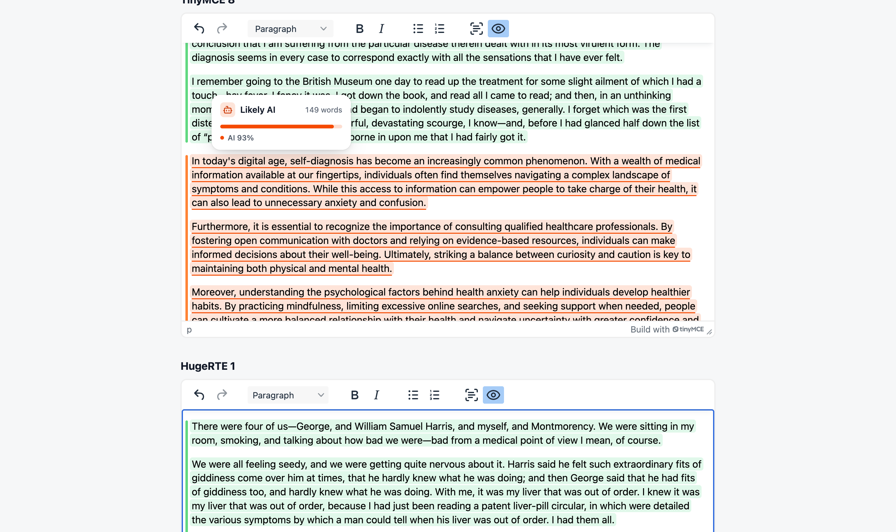

# AI detector plugin for TinyMCE and HugeRTE

Check the text in your editor for AI-written passages. One click sends the text to the [AssetFeed AI detector](https://assetfeed.com/ai-content-detector) and marks each passage beside the text:

- an orange bar for likely AI, amber for unsure, green for likely human;
- a tint behind strong passages;
- a card with the verdict, word count and score when you hover a passage.

The marks are drawn in a layer next to the document. Nothing is added to the content, to `getContent()` or to the undo history, so the saved HTML stays exactly as written.



**[Try the demo](https://assetfeed.github.io/tinymce-ai-detector/demo/)**. It works without an API key on the sample text.

Works with TinyMCE 6, 7 and 8 and HugeRTE 1.x, in the classic (iframe) mode. Inline editors get the summary only. English text only for now.

## Install

```sh
npm install @assetfeed/tinymce-ai-detector
```

```js
import tinymce from 'tinymce'            // or: import hugerte from 'hugerte'
import '@assetfeed/tinymce-ai-detector'  // registers the "aidetector" plugin on the editor global

tinymce.init({
  selector: '#editor',
  plugins: 'aidetector',
  toolbar: 'undo redo | bold italic | aidetector aidetectormarks',
  aidetector_endpoint: '/api/ai-check', // your server route, see below
})
```

Without a bundler, load the plugin file with `external_plugins`:

```js
tinymce.init({
  selector: '#editor',
  external_plugins: { aidetector: 'https://cdn.jsdelivr.net/npm/@assetfeed/tinymce-ai-detector@0.1.0/dist/aidetector.min.js' },
  toolbar: 'aidetector aidetectormarks',
  aidetector_endpoint: '/api/ai-check',
})
```

## Connect the detector

Checks use credits of an AssetFeed account. Create an API key at [assetfeed.com/api-keys](https://assetfeed.com/api-keys). Keep the key on your server: anyone who can open the page can read a key that is written into it.

Your server route forwards the request body to the AssetFeed API and adds the key:

```js
// Node 18+ (Express)
app.post('/api/ai-check', express.json(), async (req, res) => {
  const upstream = await fetch('https://api.assetfeed.com/api/v1/ai-detector/checks', {
    method: 'POST',
    headers: { 'Content-Type': 'application/json', Accept: 'application/json', 'X-Api-Token': process.env.ASSETFEED_API_KEY },
    body: JSON.stringify({ text: String(req.body.text ?? '') }),
  })
  res.status(upstream.status).type('json').send(await upstream.text())
})
```

```php
// PHP
$ch = curl_init('https://api.assetfeed.com/api/v1/ai-detector/checks');
curl_setopt_array($ch, [
    CURLOPT_POST => true,
    CURLOPT_RETURNTRANSFER => true,
    CURLOPT_HTTPHEADER => ['Content-Type: application/json', 'Accept: application/json', 'X-Api-Token: '.getenv('ASSETFEED_API_KEY')],
    CURLOPT_POSTFIELDS => json_encode(['text' => (string) (json_decode(file_get_contents('php://input'), true)['text'] ?? '')]),
]);
$body = curl_exec($ch);
http_response_code(curl_getinfo($ch, CURLINFO_RESPONSE_CODE));
header('Content-Type: application/json');
echo $body;
```

Put your own sign-in check in front of that route, so that only your editors spend your credits.

## Options

| Option | Default | |
|---|---|---|
| `aidetector_endpoint` | `https://api.assetfeed.com/api/v1/ai-detector/checks` | Where the text is posted as `{ "text": "..." }`. |
| `aidetector_api_key` | `''` | Sent as `X-Api-Token`. Only for internal tools: the key is visible in the page. |
| `aidetector_request` | none | `async ({ text }) => answer`: your own transport. Return the `data` object of the API answer. |

## Toolbar, menu and commands

| Name | |
|---|---|
| `aidetector` | Toolbar button and menu item: check the text. |
| `aidetectormarks` | Toolbar toggle: show or hide the marks. |
| `AiDetectorCheck`, `AiDetectorClear`, `AiDetectorToggleMarks` | Commands for `editor.execCommand()`. |
| `AiDetectorResult` | Editor event with `{ result }` after each answer, for your own display. |

The answer belongs to the text it was given for: the first edit after a check removes the marks. All interface strings go through `editor.translate()`, so they can be translated with the editor's language packs.

## How the text is sent

The plugin sends one line per block (paragraph, heading, list item, quote, table cell); empty blocks are skipped. The detector scores the text in windows of about 120 to 300 words, and each window names the lines it covers, which is how the marks find their blocks.

Checks made with an API key are not saved to an AssetFeed check history (see the [privacy policy](https://assetfeed.com/privacy-policy)). The score is a probabilistic estimate, not proof of how a text was written.

## Development

```sh
npm install
npm run build   # dist/aidetector.js and dist/aidetector.min.js
npm test
python3 -m http.server 8000   # then open http://localhost:8000/demo/
```

## Licence

MIT. Icons are from [Lucide](https://lucide.dev) (ISC). The demo text opens with *Three Men in a Boat* by Jerome K. Jerome (1889), which is in the public domain.
